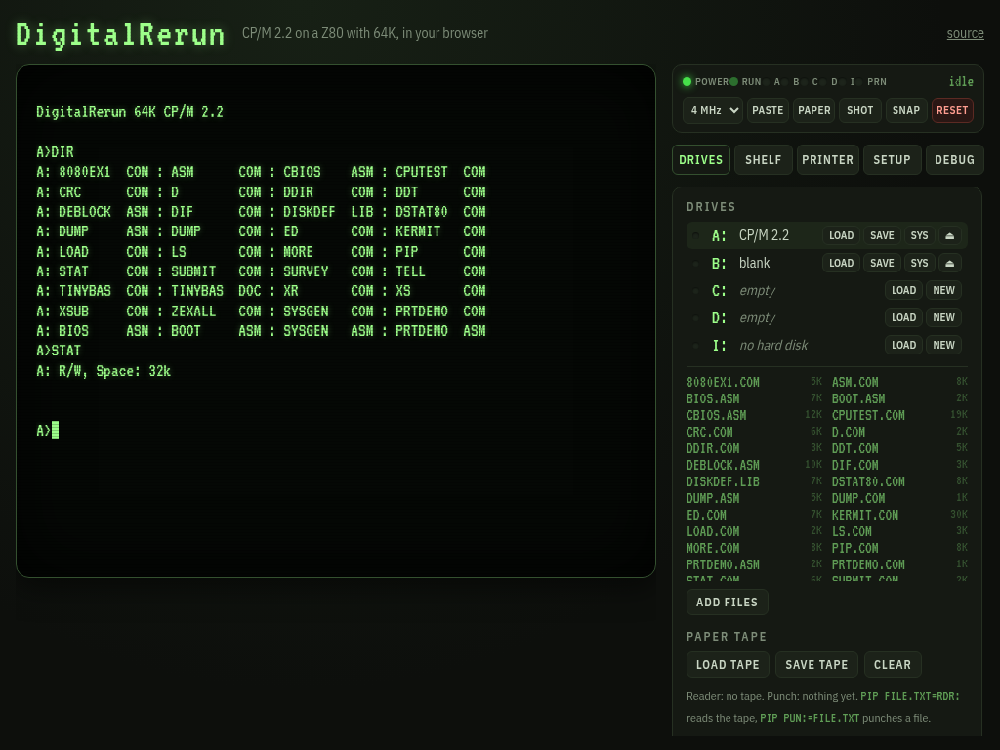
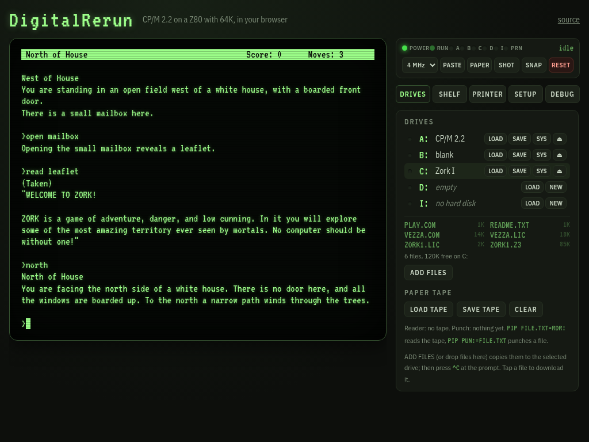

<div align="center">

# DigitalRerun

### CP/M 2.2 and CP/M 3, running again: a whole 1980s computer in your browser

[](https://github.com/cstroie/digital-rerun/actions/workflows/test.yml)
[](https://cstroie.github.io/digital-rerun/)
[](LICENSE)


**[▶ Boot it now](https://cstroie.github.io/digital-rerun/)**: no install, no sign-up, no download. &nbsp;·&nbsp; **[📖 User guide (wiki)](https://github.com/cstroie/digital-rerun/wiki)**



</div>

DigitalRerun is a complete CP/M machine that runs in a web page, with a choice of **CP/M 2.2** (the default) or **CP/M 3** (CP/M Plus, from the shelf):
- a **Z80 with 64K** of RAM;
- **8" floppy drives** and a 4 MB hard disk;
- a **VT100**, **VT52** or **ADM-3A** console with a glowing phosphor screen;
- an **FX-80 dot matrix printer** that strikes its dots onto fanfold paper, tractor holes and all.

It is not a CP/M look-alike. The machine boots the **original CP/M 2.2 CCP and BDOS**, byte for byte as they shipped, read by a real BIOS from the system tracks of an 8" disk. Everything CP/M did then, it does here: `PIP`, `ED`, `ASM`, `DDT`, `SUBMIT`. You can even rebuild the BIOS inside CP/M with the 1980 recipe and boot the result. CP/M 3 is there too: insert its disk from the shelf in A:, press `^C`, and Digital Research's own CP/M Plus boots (see [docs/cpm3.md](docs/cpm3.md)).

It is a single web page with no dependencies, no build step and no server. It installs as an app, works offline, and keeps your disks and your place between visits.

## Why you'll like it

- **The real thing.** The original CP/M 2.2 system, assembled from source by the project's own assembler into exactly the binaries on the 1979 distribution disk. A test checks every byte. CP/M 3 (CP/M Plus) boots from its own disk on the shelf, with Digital Research's own CCP, BDOS and tools.
- **A shelf of software.** Zork I, II and III, twelve more free text adventures, Signal Seeker (a cozy relay-station game written for this machine, in Z80 assembly), Z80-μLM (a tiny language model you can chat with), BBC BASIC with example programs, a public domain Forth-83 and two C compilers (BDS C and HI-TECH C), every one free to share and ready to insert into a drive. Your own disks (WordStar, MBASIC …) go on *My disks* and stay in your browser.
- **A printer you can watch.** PRTDEMO shows off pica, elite, condensed, bold, italic, underlined, enlarged, super- and subscript text and bit-image graphics. Save the pages as PNG or PDF.
- **Snapshots.** Freeze the whole machine (CPU, memory, screen and disks) and come back to that exact moment later, even mid-game. Leave the page and it resumes where you were.
- **Bring your own software.** Drop files onto the DRIVES panel to copy them to the selected drive, or LOAD a whole `.dsk` image into a drive. Make a disk from a folder on your device (FROM FOLDER), or point the SHELF tab at a private catalog on your own server: software you may not share stays on your machines. Disks use the standard 8" format of cpmtools and z80pack, plus the 5¼" ones below.
- **Hackable to the bone.** The BIOS, the boot loader and SYSGEN are short, commented 8080 sources on the boot disk. Change them with `ED`, assemble them with `ASM`, install them with `SYSGEN`.
- **It sounds right.** The bell, the clunk of an 8" drive loading its head, the clicks of the head stepping across tracks, and the rasp of the print head. All are synthesized, and a SETUP switch turns them off.
- **Screenshots.** SHOT saves the screen as a PNG, phosphor glow and scan lines included.
- **A debugger.** Registers and flags, a Z80 disassembly that follows the program, breakpoints, step and step over, and a memory view.
- **Phone friendly.** A key row adds what phone keyboards lack (CTRL, ESC, TAB, arrows, ^C), ADD FILES replaces drag and drop, the printed paper gets its own tab, and the 80 columns stay readable.
- **Paste a whole listing.** PASTE types at a careful typist's pace, waiting for the program to ask for each key, so nothing is lost, not even in programs that read the keyboard ahead.

<div align="center">



</div>

## Try it

Open **https://cstroie.github.io/digital-rerun/**, click the screen and type:

```
A>DIR                        what is on the disk
A>STAT B:                    room on the empty disk in B:
A>PIP B:=A:*.COM             copy the programs to B:
A>PRTDEMO                    print a page (see PAPER)
A>D:                         to a shelf disk, Zork I here
D>VEZZA ZORK1.Z3             and you are standing west of a white house
```

A: holds the CP/M 2.2 tools (PIP, STAT, ED, ASM, LOAD, DDT, SUBMIT, XSUB, DUMP), SYSGEN, PRTDEMO, and the sources of the BIOS, the loader and SYSGEN. B: holds an empty disk. Games and tools are on the shelf (SHELF tab): put Zork I in D: and `D:` `PLAY` starts it.

`^C` warm-starts the system, `^S` pauses the output and `^P` echoes the console to the printer. In Zork, `SAVE` and `RESTORE` keep your progress on the disk.

For CP/M 3, open the SHELF tab, put the *CP/M 3* disk in A: and press `^C` (on a phone, the **^C** key button). It boots as CP/M 3.0; try `DIR`, `SHOW` and `DATE`. To go back, put the *CP/M 2.2* disk in A: and press RESET.

## Learn more

The full guide is in the **[wiki](https://github.com/cstroie/digital-rerun/wiki/Home)**:

| | |
|---|---|
| [Getting started](https://github.com/cstroie/digital-rerun/wiki/Getting-Started), [user guides](https://github.com/cstroie/digital-rerun/wiki/User-Guides) | first steps, everyday use |
| [The interface and the app](https://github.com/cstroie/digital-rerun/wiki/Interface-and-App) | the panels, the paper drawer, phone, install, offline, updates |
| [Drives and files](https://github.com/cstroie/digital-rerun/wiki/Drives-and-Files), [the shelf](https://github.com/cstroie/digital-rerun/wiki/Shelf) | disks, formats, ADD FILES, paper tape, My disks, the private shelf |
| [The console](https://github.com/cstroie/digital-rerun/wiki/Console), [the printer](https://github.com/cstroie/digital-rerun/wiki/Printer) | VT100, VT52, ADM-3A; the FX-80 and its command set |
| [Snapshots](https://github.com/cstroie/digital-rerun/wiki/Snapshots), [the debugger](https://github.com/cstroie/digital-rerun/wiki/Debugger) | freeze and restore the machine; registers, disassembly, breakpoints |
| [Changing the system](https://github.com/cstroie/digital-rerun/wiki/Changing-the-System) | rebuild the BIOS inside CP/M, the 1980 way |
| [Technical specifications](https://github.com/cstroie/digital-rerun/wiki/Technical-Specifications) | CPU, memory, disk formats, the I/O ports |
| [Development](https://github.com/cstroie/digital-rerun/wiki/Development) | the source tree, the tools, the tests, releasing |

Also in the repository: [CP/M 3 on DigitalRerun](docs/cpm3.md) and [the private shelf](docs/private-shelf.md).


## For developers

```
git clone https://github.com/cstroie/digital-rerun.git
cd digital-rerun
python3 -m http.server 8000         # any static server; then open http://localhost:8000
node --test                         # assembler, file system, terminal, printer, CP/M 2.2 and 3, shelf disks, snapshots, PWA
ZEX=1 node --test test/zex.test.js  # ZEXDOC on the Z80 core (a few minutes; ZEX=all adds ZEXALL, CI runs both)
```

No dependencies and no build step for the app itself. `node tools/build.js` assembles the system and makes the disks; `node tools/build-cpm3.js` builds the CP/M 3 disk. To release, raise `VERSION` in [`js/version.js`](js/version.js) and run `node tools/stamp.js`. The source tree and the tools are described in the [wiki](https://github.com/cstroie/digital-rerun/wiki/Development).


## Credits

DigitalRerun stands on the work of many people, with thanks to all of them.

**CP/M**
- **Gary Kildall** created CP/M at **Digital Research, Inc.** in Pacific Grove, California. This project is named in its honour: Digital Research's system, running again.
- **DRDOS, Inc.** and its president **Bryan Sparks** granted everyone the right to use, distribute and modify CP/M and its derivatives (2022, at **Scott Chapman**'s request). See [LICENSE-DRI](LICENSE-DRI).
- **Eric Smith** reformatted the CCP and BDOS sources for cross-assembly ([brouhaha/cpm22](https://github.com/brouhaha/cpm22)); they are in `system/cpm22/`.
- **Gaby Chaudry**'s [Unofficial CP/M Web Site](http://www.cpm.z80.de/) keeps CP/M's history, its sources and the licence. It is where the CP/M 2.2 distribution files on A: and the CP/M 3 sources and binaries come from.
- **John Elliott** made the CP/M 3 build with the year 2000 fixes that is on the CP/M 3 disk.

**Emulation**
- **Molly Howell** and contributors wrote [Z80.js](https://github.com/DrGoldfire/Z80.js), the Z80 core (MIT).
- **Frank Cringle** wrote the ZEXDOC/ZEXALL instruction exercisers (GPL). **Tony Nicholson** keeps them at [agn453/ZEXALL](https://github.com/agn453/ZEXALL). They are downloaded by the test and not shipped.
- **Udo Munk**'s [z80pack](https://github.com/udo-munk/z80pack) set the I/O port layout and the disk formats. **Michael Haardt**'s [cpmtools](http://www.moria.de/~michael/cpmtools/) `diskdefs` give the geometry of every format here.
- The 5¼" formats are those of the Kaypro II, the Kaypro 4 and the Osborne 1, read as cpmtools reads their images.
- The 8" format is the IBM 3740 single-sided, single-density layout.
- The printer follows the published command set of the **Epson FX-80**. Its 9-pin font was drawn for this project, not copied from Epson's character ROM.

**Zork I**
- *Zork I: The Great Underground Empire* is by **Marc Blank** and **Dave Lebling** at **Infocom, Inc.**, from the original MIT *Zork* by **Tim Anderson, Marc Blank, Bruce Daniels and Dave Lebling**.
- In 2025 **Microsoft**'s Open Source Programs Office, **Team Xbox** and **Activision**, working with **Jason Scott** of the Internet Archive, released it under the MIT licence ([historicalsource/zork1](https://github.com/historicalsource/zork1)). `disks/shelf/zork1/ZORK1.Z3` is that repository's compiled story file.
- **Shawn Sijnstra** wrote [Vezza](https://gitlab.com/sijnstra1/vezza), the Z-machine interpreter for CP/M that plays it (GPL-2.0-or-later). `disks/shelf/zork1/VEZZA.COM` is its `vezza-C2` build, unchanged.

**The shelf**
- **HarryR** wrote [Z80-μLM](https://github.com/HarryR/z80ai), the 2-bit language model on the Z80-μLM disk (CHAT.COM and GUESS.COM, from its release v0.2, unchanged), under MIT or Apache-2.0, as you see fit.
- **Dave Bernazzani** (Moonglow, Cat's Eye), **Johan Berntsson** (The Fantasy Dimension) and **Garry Francis** (Submarine Sabotage) wrote the Z3 games on their own disks. **Will Crowther** and **Don Woods** wrote Colossal Cave Adventure; **Tara McGrew** ported it to ZIL (Graham Nelson and Dave Baggett's earlier work, with elements of the Fortran original restored). They are freeware in the [IF Database](https://ifdb.org) and come unchanged from the [IF Archive](https://ifarchive.org/if-archive/games/zcode/); their authors keep their rights, so they may be shared, not sold.
- **Graham Nelson** (Curses), **Sam Barlow** (Aisle), **Adam Cadre** (9:05, Photopia), **Andrew Plotkin** (Shade, Spider and Web) and **David Fisher** (Suveh Nux) wrote the Z5 games on their own disks. They are freeware in the [IF Database](https://ifdb.org) and come unchanged from the [IF Archive](https://ifarchive.org/if-archive/games/zcode/); their authors keep their rights, so they may be shared, not sold. The story file of Spider and Web is the archive's `Tangle.z5`.
- **Henry Laxen** and **Michael Perry** wrote F83 and placed it in the public domain; the copy is the [Forth Interest Group](http://www.forth.org/eforth.html)'s F83V2-80 archive, as mirrored at [janaite/forth83-80](https://github.com/janaite/forth83-80).
- **R.T. Russell** wrote [BBC BASIC (Z80)](https://github.com/rtrussell/BBCZ80) and shares it under the zlib licence. The example programs were written for DigitalRerun.
- **Leor Zolman** (BD Software) wrote [BDS C](https://www.bdsoft.com/resources/bdsc.html) and placed it in the public domain in 2002.
- **HI-TECH Software** made its Z80 C compiler free for any use; **Tony Nicholson** keeps it updated at [agn453/HI-TECH-Z80-C](https://github.com/agn453/HI-TECH-Z80-C).

**Fonts**
- [VT323](https://fonts.google.com/specimen/VT323) by **Peter Hull**, and [IBM Plex Sans Condensed](https://github.com/IBM/plex) by **Mike Abbink** and **Bold Monday**, both under the SIL Open Font License.

## Licence

DigitalRerun's own code is under the [MIT licence](LICENSE). The parts that come from elsewhere keep their own licences, listed in [LICENSE](LICENSE):
- CP/M 2.2 and CP/M 3 under the DRDOS, Inc. grant ([LICENSE-DRI](LICENSE-DRI));
- Z80.js under MIT;
- Zork I under MIT;
- Vezza under GPL-2.0-or-later (its licence is in `disks/shelf/zork1/`);
- Z80-μLM under MIT or Apache-2.0 (`disks/shelf/z80ulm/`);
- F83 in the public domain, and twelve Z-machine games as freeware (`disks/shelf/forth83/`, `advent/`, `catseye/`, `fantasy/`, `moonglow/`, `subsab/`, `curses/`, `aisle/`, `905/`, `photopia/`, `shade/`, `spiderweb/`, `suvehnux/` under `disks/shelf/`).

**Trademarks.** CP/M was created by Gary Kildall at Digital Research, Inc.; the rights now belong to DRDOS, Inc. Epson and FX-80 are trademarks of Seiko Epson Corporation. Z80 is a trademark of Zilog, Inc. IBM and IBM Plex are trademarks of International Business Machines Corporation. Kaypro and Osborne are the names of their makers. VT100 and VT52 were terminals by Digital Equipment Corporation, and ADM-3A one by Lear Siegler, Inc. ZORK is a trademark of its owner. Names are used only to say what DigitalRerun emulates or contains. DigitalRerun is not affiliated with, or endorsed by, any of these companies.
